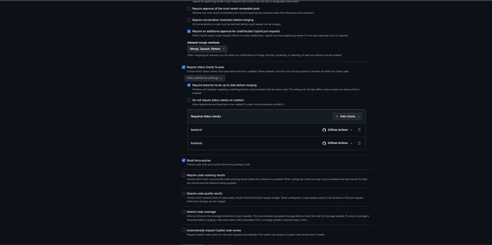
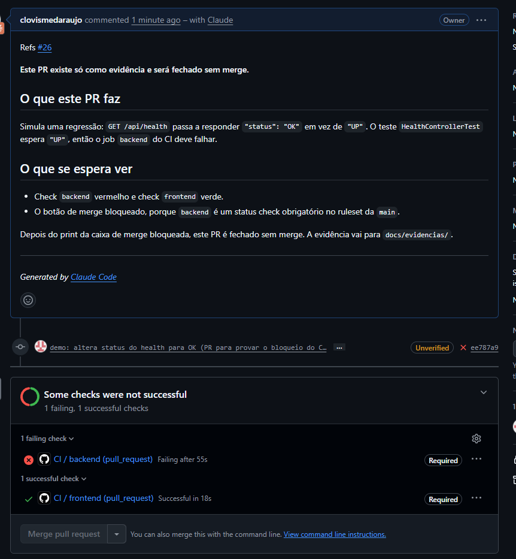

# Evidências — Pipeline de CI e proteção da `main` (Sprint 2)

## 1. Proteção da `main` (cartão #23)

Desde 16/11/2026, a `main` é protegida por um **ruleset** do GitHub (Settings → Rules → Rulesets) com:

- **Enforcement:** Active, sem ninguém na lista de bypass;
- **Require a pull request before merging:** todo trabalho entra por PR, sem push direto;
- **Require status checks to pass:** os checks `backend` e `frontend` (GitHub Actions) são obrigatórios, com a branch atualizada em relação à `main`;
- **Block force pushes** e **Restrict deletions**.

## 2. PR quebrado é bloqueado (cartão #26)

- **PR de demonstração:** [#42](https://github.com/clovismedaraujo/campusgigs/pull/42), fechado sem merge.
- **Mudança:** `GET /api/health` passou a responder `"status": "OK"` em vez de `"UP"`, simulando uma regressão.
- **Execução do CI:** [Actions run 44134929918](https://github.com/clovismedaraujo/campusgigs/actions/runs/44134929918).
  - O job `backend` falhou em `HealthControllerTest.shouldReturnHealthStatusUp`: `JSON path "$.status" expected:<UP> but was:<OK>`.
  - O job `frontend` passou.
- **Resultado:** os dois checks aparecem como **Required** e o botão **Merge pull request** ficou desabilitado.

## 3. O que o CI verifica em todo push e PR

Workflow: [`.github/workflows/ci.yml`](../../.github/workflows/ci.yml)

| Job | Etapas |
|---|---|
| `backend` | `mvn -B verify`: Checkstyle (lint, fase `validate`), compilação e 31 testes JUnit contra PostgreSQL 16 |
| `frontend` | `npm ci` → `npm run lint` (ESLint, zero avisos) → `npm test` (Vitest) → `npm run build` |
